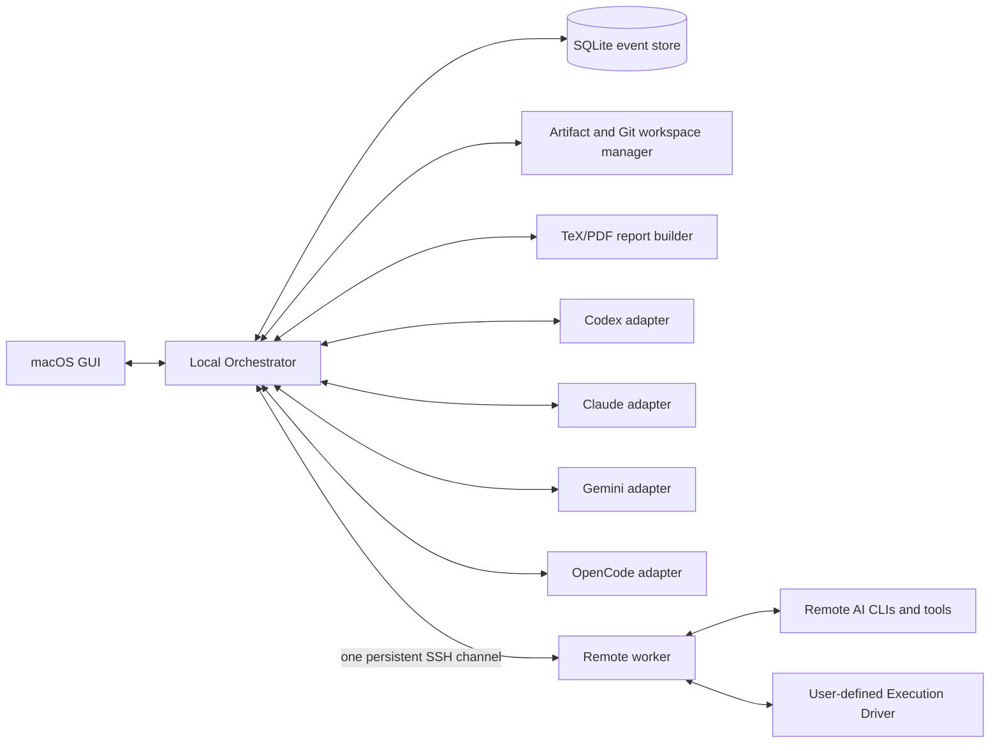

# Scientelier（旧称Agent Harness）拡張構想（旧要求仕様書）

- 文書版: 0.1-draft
- 更新日: 2026-09-11
- 対象: macOS上で複数のAI CLIとローカル・遠隔計算環境を統合運用するデスクトップアプリケーション
- 状態: 将来拡張の検討資料。MVPの正本ではない

## 1. 目的

Agent Harnessは、Claude Code、Codex、Gemini CLI、OpenCodeなどのCLI型AIエージェントを、単一のGUIから安全に実行・監視・連携させる。

主な目的は次のとおりである。

1. 複数のCLIにタスクを割り当て、並列実行、相互レビュー、成果物統合を行う。
2. CLIまたはモデルの利用上限・レート制限・推定コストを観測し、作業を中断させずに再配置または引き継ぐ。
3. ローカルMacと、SSH越しのサーバ・スパコンを同じ操作体系で扱う。
4. Slurm等のバッチジョブシステムを、登録済みの環境プリセットから利用する。
5. コーディング、調査、分析、図表作成、資料作成の履歴と結果を、必ずTeXソースおよびPDF報告書として残す。

本システムは、プロバイダーの制限を回避するためのアカウント切替ツールではない。各サービスの利用規約、認証方式、同時実行制限に従い、許可されたCLI・モデル・アカウントの範囲で負荷を配分する。

## 2. 設計原則

### 2.1 オーケストレーター中心

エージェント同士は互いのプロセスへ直接接続しない。すべての指示、質問、レビュー、引き継ぎは、共通メッセージ形式を使ってオーケストレーター経由で行う。これにより、監査、再実行、ループ防止、権限制御を可能にする。

### 2.2 CLI依存部分の隔離

各CLIの起動方法、イベント形式、セッション継続、モデル選択、利用量取得、承認要求は、個別のアダプターに閉じ込める。中核機能は特定CLIの出力形式に依存しない。

### 2.3 セッション継続を優先

長い処理を毎回単発コマンドとして起動せず、可能な限りCLI固有のセッション、サーバAPI、または永続PTYを使用する。引き継ぎが必要な場合も、生の全会話ではなく、検証可能な「引き継ぎパッケージ」を渡す。

### 2.4 共有作業領域の衝突を防ぐ

コーディングタスクでは、原則として実行単位ごとにGit worktreeまたは独立作業ディレクトリを割り当てる。同じファイルへの同時書き込みは禁止し、統合はレビュー済みパッチまたはコミット単位で行う。

### 2.5 観測値の信頼度を明示

「トークン数」「費用」「残量」は次の4種類を混同しない。

- `reported`: CLIまたはプロバイダーが返した公式値
- `calculated`: 公式トークン数と価格表から計算した値
- `estimated`: ローカル推定またはユーザー設定に基づく値
- `unknown`: 取得手段がなく、不明な値

サブスクリプション型サービスでは、トークン数がそのまま残り利用量や金額に対応しない場合がある。その場合、GUIは「残高」を推測で断定せず、プロバイダーが返す使用率、リセット時刻、または不明表示を使用する。

### 2.6 最小権限と人間による承認

各タスクは、読取専用、作業領域書込、ネットワーク許可、遠隔実行、バッチ投入などの権限を明示的に持つ。危険な操作や権限拡大はGUIで承認を求め、誰が何を許可したかを記録する。

## 3. 想定利用者と運用形態

MVPは、1台のMacを使う単一ユーザー向けローカルアプリケーションとする。チーム共有、Web公開、複数ユーザーRBACはMVP対象外とする。

利用者は以下を事前登録できる。

- 使用するAI CLIと実行ファイル
- CLIの認証状態への参照。ただし認証トークン自体は原則として本システムへ複製しない
- 利用可能なモデルと、用途別の優先順位
- ローカルプロジェクト
- `~/.ssh/config` 内のSSHホスト別名
- 遠隔システムの作業領域、初期化手順、バッチスケジューラー、キュー、モジュール、環境
- TeXテンプレート、プロット規約、報告書出力先

## 4. 全体アーキテクチャ



### 4.1 macOS GUI

タスク作成、実行状況、会話、成果物、利用量、承認、遠隔接続、PDF報告書を表示する。GUI自身はCLIプロセスやSSHを直接管理せず、ローカルオーケストレーターへ要求する。

### 4.2 ローカルオーケストレーター

以下を担当する常駐プロセスとする。

- タスクグラフと実行キュー
- ルーティングおよび負荷分散
- CLIプロセスとセッションの監督
- エージェント間メッセージ配送
- 権限・承認・監査
- 利用量の正規化
- 遠隔ワーカーとの接続維持
- 成果物管理と報告書生成
- クラッシュ後の状態復元

GUIとのローカル通信はUnix domain socketを第一候補とする。外部ネットワークへ待受ポートを公開しない。

### 4.3 イベントストア

SQLiteを使用し、タスク、実行、メッセージ、利用量、承認、成果物、障害、引き継ぎを追記型イベントとして保存する。現在状態はイベントから再構成できるようにし、GUI表示用の派生テーブルを併用してよい。

### 4.4 CLIアダプター

各アダプターは共通インターフェースを実装する。

```text
probe()                 インストール、版、認証状態、機能を検出
listModels()            選択可能なモデルを取得
startSession(config)    セッションを開始
resumeSession(id)       セッションを再開
send(input)             メッセージまたはタスクを投入
steer(input)            対応時のみ、実行中ターンへ追加指示
interrupt()             安全な中断を要求
approve(decision)       CLI由来の承認要求へ応答
streamEvents()          正規化前イベントを購読
usage()                 利用量・制限を取得
checkpoint()            引き継ぎ可能な状態を生成
dispose()               プロセスと資源を解放
```

アダプターは機能を偽装せず、次のような capability flags を返す。

```text
structured_events, resumable_session, mid_turn_steer,
model_selection, token_usage, cost_usage, rate_limit_status,
interactive_approval, file_diff, native_review, remote_safe
```

### 4.5 CLI別の初期接続方針

| CLI | 第一候補 | フォールバック | 初期評価 |
|---|---|---|---|
| Codex | App Server | `codex exec --json` | セッション、JSONイベント、承認、レビュー、利用量、アカウント制限を統合しやすい |
| Claude Code | 非対話モードのstream-json入出力 | PTY | セッションID、構造化イベント、ターン数、費用情報を取得可能な範囲で利用 |
| Gemini CLI | headlessのstream-json | PTY | セッション、ツールイベント、集計およびモデル別トークン統計を利用 |
| OpenCode | headless server/OpenAPIとイベント | CLI JSON/PTY | セッション、モデル、イベント、統計をAPI経由で扱う |

各CLIの版更新でプロトコルが変化するため、対応版の範囲、検出した版、生成済みスキーマのハッシュを実行記録へ保存する。未知の版では破壊的操作を自動許可しない。

### 4.6 エージェント間通信の実装

通信を一つの規格へ固定せず、次の3層に分ける。

1. `Agent Control`: オーケストレーターが各CLIのセッション、入力、イベント、承認、中断を制御する層
2. `Collaboration`: タスク、メッセージ、成果物、レビュー、引き継ぎを表現するCLI非依存の層
3. `Transport`: stdio、Unix socket、永続SSH、HTTP/WebSocket等でデータを運ぶ層

Agent Controlは、JSON-RPCベースの内部プロトコルを定義する。Agent Client Protocol（ACP）と共通するセッション・更新・承認モデルを参考にし、CLIがACPへ対応する場合は直接接続できるようにする。Codex App Server、OpenCode server、各CLIのJSON streamなどはアダプターで同じ内部イベントへ正規化する。

Collaborationは、Agent2Agent（A2A）のtask、message、artifact、capabilityという考え方との互換性を意識する。ただし、MVPでA2Aの全仕様や外部公開サーバーを実装する必要はなく、ローカル利用に必要な部分集合を内部スキーマとして実装する。

エージェントからCollaboration層を操作する第一の手段として、Agent Harnessが提供する共通MCPサーバーを接続する。最低限、次のツールを提供する。

```text
harness.get_task()           現在の目的、制約、完了条件を取得
harness.send_message()       他エージェントまたはユーザーへ送信
harness.read_messages()      未読メッセージを取得
harness.publish_artifact()   成果物とメタデータを登録
harness.request_review()     レビューを依頼
harness.submit_review()      構造化レビューを提出
harness.checkpoint()         引き継ぎ可能な状態を保存
harness.report_progress()    進捗、障害、次の作業を報告
```

遠隔CLIには遠隔ワーカーが同じMCP表面を提供し、要求を永続SSHチャネル経由でローカルオーケストレーターへ中継する。

MCPまたは同等のツール呼出に対応しないCLIでは、アダプターがターン開始時に未読メッセージを共通エンベロープとして入力へ追加し、ターン完了時の構造化出力から送信要求を取り出す。最終フォールバックとして、作業領域内の追記専用JSONL mailboxを使用できるが、通常のリアルタイム通信には使わない。

通信方式の優先順位は次のとおりとする。

| 方式 | 用途 | 長所 | 短所 | 位置付け |
|---|---|---|---|---|
| CLI固有API/ACP | CLI制御 | 構造化、双方向、承認・中断を扱いやすい | 対応状況に差がある | Agent Controlの第一候補 |
| MCP tools | エージェントによる送受信・成果物登録 | 多くのCLIへ同じツールを提示できる | 自発的なpush受信には向かない | Collaborationの第一候補 |
| アダプターによるprompt注入 | 未対応CLIへの配送 | ほぼすべてのCLIで利用できる | 遅延、文脈消費、誤解釈の可能性 | ターン境界の標準fallback |
| ローカルmessage bus | GUI、worker、adapter間イベント | push、購読、再送を実装しやすい | LLM自身が直接扱うものではない | 内部基盤 |
| ファイルmailbox | オフライン復旧、最小互換 | 単純で遠隔でも残る | polling、競合、改ざん対策が必要 | 最終fallback |
| CLI間の直接接続 | なし | 一見単純 | 監査不能、ループ、認証・版依存 | 採用しない |

実行中入力に対応するCLIであっても、再現性を優先し、緊急停止以外は原則として安全なターン境界で配送する。メッセージには配信確認と処理確認を別々に記録し、未処理のまま実行が完了した場合は再割当または次Runへ引き継ぐ。

MVPの内部message busは外部ミドルウェアを必須にせず、SQLite上のdurable inbox/outboxと、プロセス内のlive通知を組み合わせる。GUIと別プロセスadapterにはUnix domain socketで通知し、遠隔workerには永続SSH上の論理チャネルで配送する。将来複数ユーザー・複数daemonへ拡張する場合だけ、NATS等の外部brokerを検討する。

エージェントは他CLIのプロセス、セッションDB、認証情報を直接操作しない。誰から誰へ何が配送されたかは、必ずMessageイベントとして残す。

## 5. 共通データモデル

### 5.1 主要エンティティ

- `Project`: 利用者が管理する論理プロジェクト
- `Workspace`: ローカルまたは遠隔の作業領域
- `Task`: 目的、制約、依存関係、完了条件を持つ作業単位
- `Run`: あるTaskを、あるAgentSessionで実行した試行
- `AgentProfile`: CLI、モデル、役割、能力、権限、ルーティング設定
- `AgentSession`: CLI固有セッションとの対応
- `ExecutionHost`: localまたは登録済み遠隔システム
- `Message`: ユーザー・オーケストレーター・エージェント間の記録
- `Artifact`: ファイル、パッチ、コミット、図、データ、ログ、レポート
- `UsageSample`: トークン、費用、使用率、上限、リセット時刻と信頼度
- `Approval`: 要求内容、決定、決定者、適用範囲、有効期限
- `Handoff`: 引き継ぎパッケージ
- `Report`: TeXソース、PDF、ビルドログ、検証結果

### 5.2 タスク状態

```text
draft -> queued -> assigned -> running
running -> waiting_approval | waiting_dependency | waiting_remote | reviewing
running/reviewing -> reporting -> completed
任意の実行状態 -> paused | failed | cancelled
failed -> queued（再試行または別エージェントへの引き継ぎ）
```

`completed` は、タスクの完了条件を満たし、必須レポートのPDF生成と検証にも成功した状態とする。コードや分析が完了してもPDF生成が失敗した場合は `reporting_failed` とし、成果自体を失敗扱いにしない。

### 5.3 メッセージ種別

- `instruction`: 作業指示
- `question`: 他エージェントまたはユーザーへの質問
- `answer`: 質問への回答
- `progress`: 進捗
- `review_request`: 成果物のレビュー依頼
- `review_result`: 重要度、根拠、対象箇所を含むレビュー
- `handoff`: 引き継ぎ通知
- `approval_request`: 外部作用を伴う操作の承認要求
- `system_event`: 制限、切断、障害、再接続など

各メッセージは `id`, `task_id`, `run_id`, `from`, `to`, `created_at`, `type`, `body`, `artifact_refs`, `reply_to`, `hop_count` を持つ。

エージェント間の自動会話には、最大往復数、最大トークン、締切、重複質問検出を設定する。無制限の自動討論は禁止する。

## 6. タスク分解、割当、負荷分散

### 6.1 タスク定義

タスクは最低限、以下を持つ。

- 目的
- 入力と参照成果物
- 完了条件
- 許可された作業領域
- 必要能力（coding、research、analysis、plot、document、review等）
- 実行場所（local、特定host、任意）
- 予算（時間、トークン、費用、エージェント往復数）
- 依存タスク
- レビュー方針
- 報告書の章・テンプレート

### 6.2 ルーティング

候補エージェントを以下の順で絞り込み、スコアリングする。

1. 必須能力と権限を満たすか
2. 指定された実行環境へ到達できるか
3. モデルとCLIが利用可能か
4. レート制限または使用上限に余裕があるか
5. 既存セッション継続による文脈保持の利益
6. 予想費用と予想完了時間
7. 現在の並列数、過去の成功率、タスク親和性

ルーターは「最安」「最速」「品質優先」「上限温存」「手動固定」のポリシーを選択可能とする。MVPではルールベースとし、自己学習型ルーターは対象外とする。

### 6.3 モデル選択ポリシー

AgentProfileまたはTaskごとに、次を設定できるようにする。

- 固定モデル、または順序付きの許可モデル候補
- CLI/プロバイダーをまたぐフォールバック可否
- 品質、速度、費用、コンテキスト長の優先度
- reasoning/effort等のプロバイダー固有設定
- 画像、Web、ツール呼出などの必須能力
- タスク単位および日次のソフト・ハード予算

実行中にモデルを暗黙変更しない。制限到達、モデル停止、予算超過などで変更が必要な場合は、ポリシーに従って新しいRunまたは明示的なセッション遷移を作り、変更前後のモデル、理由、引き継いだ文脈を記録する。固定モデル指定をフォールバックで上書きしない。

### 6.4 競合防止

- 同じGit worktreeを複数の書込エージェントへ同時割当しない。
- 読取専用レビューは同じコミットを並列参照できる。
- 統合前に差分、テスト結果、ベースコミットを確認する。
- エージェント自身に直接マージさせず、オーケストレーターの統合キューを通す。
- 非Gitのデータ・文書タスクでは、成果物単位のleaseとバージョン番号を使用する。

## 7. 相互レビュー

レビューは独立したTask/Runとして記録する。作成者と同一のCLI・モデルを避ける設定を既定とするが、利用可能なエージェントが1つしかない場合は自己レビューを許可し、その事実を表示する。

レビュー結果の共通形式は以下とする。

```text
verdict: approve | approve_with_notes | changes_requested | inconclusive
findings[]:
  severity: critical | high | medium | low | note
  category: correctness | security | performance | reproducibility | style | evidence
  target: artifact + location
  claim: 問題の要約
  evidence: 再現手順、ログ、引用、または根拠
  proposed_fix: 任意
verification: 実施した確認
```

多数決だけで正しさを決めない。重大な指摘はテスト、一次資料、再計算、差分などの証拠で解消する。

## 8. レート制限、使用量、費用

### 8.1 正規化する指標

- 入力トークン、キャッシュ入力、出力トークン、推論トークン
- セッション、タスク、CLI、モデル、アカウント、時間窓別の集計
- API従量課金額
- サブスクリプションの使用率または残量（取得可能な場合のみ）
- レート制限状態、リセット予定時刻、最終更新時刻
- 同時実行数と待ち行列
- 値の出所と信頼度

費用計算に使った価格表の出所、取得日、通貨、価格版をUsageSampleへ記録する。サブスクリプションに含まれる利用量をAPI従量課金へ換算して「残金」と表示しない。

### 8.2 状態

```text
healthy | warning | throttled | exhausted | auth_error | offline | unknown
```

各プロバイダーのエラー、レスポンスヘッダー、CLIイベント、公式利用量APIをアダプターで正規化する。文字列ログの曖昧な解析だけに依存しない。

### 8.3 事前負荷分散

使用率、消費速度、予想タスク量、リセット時刻から枯渇リスクを計算し、警告閾値を超えた場合は新規タスクを別エージェントへ送る。実行中タスクを頻繁に移すと文脈損失が増えるため、原則としてターン境界またはチェックポイントでのみ移動する。

### 8.4 制限到達時の処理

1. 制限エラーを検出し、通常障害と区別する。
2. 現在のファイル差分、成果物、検証結果、残作業を固定する。
3. 引き継ぎパッケージを作成する。
4. 適切な別エージェントへ再割当する。
5. 新エージェントが入力を確認し、再開可否を返す。
6. 再実行による重複外部作用がないことを確認して継続する。

再試行は指数バックオフとjitterを用い、リセット時刻が分かる場合はそれを優先する。

## 9. 引き継ぎパッケージ

引き継ぎでは、CLI固有の隠れた会話状態に依存せず、以下を保存する。

- 元タスクの目的、制約、完了条件
- 完了済み作業と未完了作業
- 重要な判断とその根拠
- ベースコミット、現在の差分または成果物版
- 変更ファイル一覧
- 実行したテスト、コマンド、結果
- 発生中の障害と再現方法
- 参照資料と引用位置
- 作業環境、モデル、CLI版
- 利用量スナップショット
- 元セッションIDへの参照
- 次の一手の提案

全会話ログは監査用に保持できるが、引き継ぎ入力には必要部分だけを渡す。秘密情報、認証情報、不要な大量ログは自動で除外またはマスクする。

## 10. 遠隔実行

### 10.1 接続方式

既定方式は、ローカルから一度だけSSHを開始し、遠隔ログイン先で `agent-harness worker --stdio` を起動する永続セッションとする。以後のコマンド、イベント、承認、ファイル転送、ジョブ操作は、そのセッション上のフレーム化プロトコルで多重化する。

SSH接続断を想定し、heartbeat、再接続、要求ID、冪等性キー、遠隔状態の再同期を実装する。再接続時に同じ操作を二重実行しない。

施設の方針によりログインノード常駐プロセスが許可されない場合は、以下をプリセットで選べるようにする。

- SSH stdioワーカー
- SSHトンネル経由で既存の遠隔ワーカーへ接続
- 管理された `tmux` セッションへ再接続
- 制限付きPTYモード

### 10.2 遠隔システムプリセット

プリセットは秘密情報を含まないYAML/JSONとして管理し、概ね以下を持つ。

```yaml
id: system-name
ssh_alias: entry-in-ssh-config
connection_mode: stdio-worker
remote_worker: /path/to/agent-harness
project_roots:
  - /work/user/projects
shell: bash
init_steps:
  - module purge
  - module load texlive
execution_driver:
  kind: declarative
  definition: drivers/system-name.yaml
  profile: default
file_policy:
  max_inline_bytes: 1048576
  allowed_roots:
    - /work/user/projects
```

`drivers/system-name.yaml` には、そのシステム固有の投入、状態取得、取消、ログ取得、成果物回収と、それぞれの出力parserを登録する。Slurm等の名称は例や同梱presetとして扱い、system presetのスキーマ自体には固定しない。

SSH秘密鍵、パスフレーズ、OAuthトークン、APIキーはプリセットへ保存しない。macOS Keychain、SSH Agent、CLI自身の認証ストアを利用する。

### 10.3 遠隔作業の境界

- 許可済みroot外のファイルへアクセスしない。
- ログインノードでの重い計算を禁止できる。
- CLI実行をログインノードで許すか、計算ノードだけで許すかをシステムごとに設定する。
- 接続先ホスト鍵の変更を自動受諾しない。
- 踏み台は `~/.ssh/config` の `ProxyJump` 等へ委譲する。
- 大容量ファイルはハッシュ、圧縮、再開可能転送を使用する。

### 10.4 tmuxの位置付け

tmuxは使用可能とするが、通信プロトコル、イベントストア、タスク状態の正本にはしない。次の用途に限定すると有効である。

- 遠隔workerまたはPTYしか持たないCLIを、SSH切断後も生存させる
- 利用者が遠隔端末へ手動attachして状態を観察・復旧する
- workerを配置できない環境での互換モード
- 長い対話型セットアップを一時的に保持する

一方、pane出力のスクレイピングを主要なイベント取得手段にはしない。ANSI制御列、scrollback欠落、プロンプト判定、承認入力、複数paneとの対応付けが不安定になるためである。

遠隔接続モードは次の3種類を用意する。

1. `attached-worker`: 1本のSSH stdioセッション内でworkerを実行する。構成が簡単だが、SSH切断時にworkerも終了し得る。
2. `detached-worker`: 遠隔workerを施設で許可された方法で常駐させ、再接続する。systemd user service、scheduler allocation、tmux等はsystem presetで選択する。
3. `tmux-compat`: tmux内のCLIへPTYとして接続する。手動復旧性は高いが、利用量、承認、構造化イベント等の機能は制限される。

バッチジョブの永続性はtmuxではなくスケジューラーとjob IDで確保する。ログインノード上のtmux/常駐workerが許可されるかは施設ごとの運用規約に従う。

## 11. バッチジョブ

特定の製品名に依存しない `Execution Driver` インターフェースを定義する。スケジューラーのないシステム、独自ラッパーを持つシステム、Slurm/PBS/LSF/SGE等を同じライフサイクルで扱う。

```text
probe() -> capabilities
validate(script, resources, environment)
submit(script, resources) -> job_id
status(job_id)
cancel(job_id)
tail(job_id, stream)
collect(job_id, artifact_rules)
account(job_id)                 任意: 実績資源量・課金情報
allocate(resources)             任意: 対話割当
release(allocation_id)          任意: 対話割当の解放
```

ユーザーはシステムごとに、次のいずれかでExecution Driverを登録できる。

1. `built-in`: Slurm等の同梱ドライバーを選び、コマンド名や既定値だけを上書きする。
2. `declarative`: 操作ごとのargv/template、出力parser、状態対応表をYAML/JSONで定義する。
3. `executable`: ユーザー作成プログラムがJSON-RPC over stdioで上記インターフェースを実装する。

declarative driverは次を登録可能とする。

- submit/status/cancel/tail/collect/account/allocate/releaseのコマンド
- job ID、状態、時刻、終了コードを得るJSONPath、正規表現、区切り形式parser
- システム固有状態から `queued/running/succeeded/failed/cancelled/unknown` への対応
- 資源名と単位の対応（node、core、GPU、memory、walltime等）
- 環境初期化、ジョブスクリプト、出力先のテンプレート
- 対応機能を示すcapability flags
- polling間隔、timeout、再試行可能な終了コード

シェルを必要としないコマンドはargv配列で保持する。シェルテンプレートを使う場合は「信頼済みsystem driver」として明示し、変数を許可リスト化し、展開後のスクリプトを投入前に表示する。

登録ウィザードは `probe -> dry-run -> test submit -> status -> log -> cancel/complete -> collect` を段階的に検証し、成功した機能だけを有効化する。すべてのシステムがcancel、account、対話割当等を備えるとは仮定しない。

ジョブ投入前に以下をGUIで確認できる。

- 実際に投入するスクリプト
- ノード、CPU、GPU、メモリ、時間、キュー
- 作業ディレクトリと環境初期化
- 出力・エラーログ
- 予想される課金情報（設定がある場合）

ジョブIDはTask/Runへ記録し、SSHが切れてもジョブ追跡を再開できる。再接続時に同一ジョブを再投入しない。

## 12. TeX/PDF報告書

### 12.1 必須成果物

各トップレベルタスクは次を生成する。

- `report.tex`
- `report.pdf`
- `report-manifest.json`
- TeXビルドログ
- 参照した図表、データ、引用情報

報告書は原則ローカル側の専用ビルダーで生成する。遠隔側では、分析結果、図、ログ、文献情報などの報告書断片を構造化形式で作り、ローカルへ回収する。

### 12.2 標準構成

1. 概要
2. 目的と完了条件
3. 実行環境と再現情報
4. 実施内容
5. 結果
6. 検証と相互レビュー
7. 使用量と実行時間
8. 制約、未解決事項、次の作業
9. 成果物一覧
10. 参考文献

### 12.3 ビルドと検証

- 日本語文書はLuaLaTeXを既定候補とする。
- TeXテンプレートはバージョン管理する。
- `shell-escape` は既定で無効とする。
- 引用未解決、欠落図、コンパイルエラーを検出する。
- PDFからテキストを抽出し、必須節と主要結果が存在することを検証する。
- ページ画像を生成し、図表のはみ出し、空白ページ、欠落文字を視覚検査できるようにする。
- 報告書内に実行ID、成果物ハッシュ、Git commit、CLI・モデル版を記載する。

複数エージェントが単一の `report.tex` を同時編集しない。各エージェントは構造化された章断片を提出し、報告書ビルダーだけが最終TeXを組み立てる。

## 13. GUI要件

### 13.1 ダッシュボード

- 実行中、待機中、承認待ち、失敗、完了タスク
- CLI/モデル別の稼働数と待ち行列
- 利用量、使用率、リセット時刻、推定費用、値の信頼度
- ローカルおよび遠隔ホストの接続状態
- バッチジョブ状態
- 重要アラート

### 13.2 タスク画面

- 目的、完了条件、依存関係、担当、予算
- エージェント会話を時系列またはスレッドで表示
- 各発言がユーザー、CLI、モデル、オーケストレーターのどれかを明示
- コマンド、ツール呼出、差分、成果物、承認の折り畳み表示
- 一時停止、中断、再試行、別エージェントへの引き継ぎ
- 会話の最大往復や予算を途中変更

### 13.3 成果物・レビュー画面

- ファイル、差分、コミット、図、PDF、ログを一覧表示
- 2つのエージェントの提案やレビューを比較
- 指摘を対象行または成果物へ紐付け
- 承認済み成果物だけを統合対象とする

### 13.4 エージェント・利用量画面

- CLI版、認証状態、利用モデル、機能
- 現在のセッションと割当タスク
- 期間別トークン・費用グラフ
- サブスクリプション/API課金の区別
- reported/calculated/estimated/unknownの表示
- 制限到達予測とルーティング方針

### 13.5 遠隔システム画面

- 登録済みプリセット
- 接続、heartbeat、再接続状態
- 遠隔作業領域とCLI検出結果
- バッチジョブ一覧とログ
- 実行前スクリプト確認

### 13.6 報告書画面

- PDFプレビュー
- TeXソース、ビルドログ、使用したテンプレート
- 各節の元タスク・元成果物への追跡
- 再生成と版管理

## 14. セキュリティと監査

- 認証情報は原則としてCLI、macOS Keychain、SSH Agentに保持し、本システムDBへ平文保存しない。
- ログ保存前に既知のトークン、環境変数、秘密鍵、資格情報をマスクする。
- コマンドは引数配列として扱い、シェル文字列連結を避ける。
- リポジトリ内の指示ファイルや外部文書を信頼済みシステム指示と同列に扱わない。
- 破壊的操作、外部公開、送信、課金増加、遠隔ジョブ投入は承認ポリシーを適用する。
- 承認は一回、実行単位、セッション、プロジェクト単位を区別し、有効期限を持つ。
- 監査ログにはプロンプト、モデル出力、コマンド、差分、承認、通信相手、時刻を記録する。ただし秘密情報は除外する。
- 遠隔ワーカーのバージョンと署名またはハッシュを検証する。
- GUIやローカルAPIを外部インターフェースへ既定公開しない。

## 15. 障害回復

- オーケストレーター再起動後、実行中だったRunを `recovering` として再照合する。
- CLIプロセスが残っていれば再接続し、残っていなければセッション再開または引き継ぎを試みる。
- 遠隔切断時、ローカル状態を失敗にせず `waiting_remote` とする。
- バッチジョブはジョブIDで再照合する。
- 外部作用を伴う要求には冪等性キーを付ける。
- 完了イベントを受信できなかった場合、成果物とプロセス状態を確認してから再実行する。

## 16. 非機能要件

### 16.1 信頼性

- タスク、承認、外部作用、成果物登録は、クラッシュ直前の状態まで復元できる。
- イベント配送はat-least-onceを基本とし、受信側でイベントIDにより重複排除する。
- CLIまたは遠隔ホスト1台の障害が、他の実行中タスクを停止させない。
- Macのスリープ・復帰後に、プロセス、SSH、ジョブ状態を再照合する。

### 16.2 性能目標

- ローカルCLIイベントは、通常時1秒以内にGUIへ反映する。
- MVPは少なくとも4つの同時AgentSessionを安定して監視する。
- 長大な会話やログは仮想スクロールと段階読込を使用し、全件をGUIメモリへ展開しない。
- 大容量成果物はDBへ直接格納せず、ファイルとハッシュを管理する。

### 16.3 保守性と互換性

- アダプターは中核プロセスから分離して更新可能にする。
- 対応CLI版と機能試験結果を自動表示する。
- 共通イベント、メッセージ、引き継ぎ、報告書断片はJSON Schemaで版管理する。
- 未知フィールドを許容し、未知の危険操作は拒否する前方互換方針とする。

### 16.4 データ管理

- 保存先、保持期間、会話本文を保存しないモードをプロジェクト単位で設定できる。
- プロジェクトは、DBメタデータ、監査ログ、成果物、TeX/PDFを含む可搬bundleとしてexportできる。
- 削除時は、DB記録、作業領域、CLI固有セッションが別管理であることを示し、削除対象を個別確認する。

## 17. MVP範囲

### 17.1 MVPに含める

1. macOS単一ユーザーGUI
2. ローカルオーケストレーターとSQLiteイベントストア
3. Codex、Claude Code、Gemini CLI、OpenCodeのアダプター。ただし機能差をGUIで明示する
4. タスク作成、手動割当、自動ルーティング、並列実行
5. エージェント間メッセージ、レビュー、引き継ぎ
6. Git worktreeによる書込分離
7. 利用量の収集と信頼度表示
8. 1本の永続SSH接続を使う遠隔ワーカー
9. built-in、declarative、executableの各ユーザー登録Execution Driverによる投入、状態確認、取消、ログ、成果物回収
10. TeX/PDF報告書の自動生成と検証
11. 承認UI、秘密情報マスク、監査ログ

### 17.2 MVPから除外

- 複数ユーザー、チーム共有、クラウド型中央サーバ
- モバイルアプリ
- プロバイダーアカウントの購入・自動作成・自動切替
- 利用規約またはレート制限の回避
- AIによる無制限の自律的タスク生成
- すべてのバッチスケジューラーを本体へ個別実装すること
- エージェントの評価に基づく自己学習ルーター
- GUIからの秘密鍵・APIキー管理

## 18. MVP受入条件

以下を一つのデモシナリオで満たすこと。

1. GUIからGitプロジェクトを登録し、実装タスクを作成できる。
2. Agent Aが独立worktreeで変更し、機械可読イベントと利用量がGUIへ逐次表示される。
3. Agent Bがその差分を読取専用でレビューし、構造化された指摘を返す。
4. 指摘に基づく修正とテスト結果が成果物として保存される。
5. Agent Aを模擬レート制限状態にすると、チェックポイントからAgent Cへ重複実行なく引き継げる。
6. 遠隔プリセットへ一度のSSHログインで接続し、複数の状態確認を追加ログインなしで行える。
7. 登録したサンプルExecution Driverでジョブを投入し、SSH再接続後も同じジョブIDを追跡できる。
8. 最終的にTeX、PDF、manifest、差分、テストログ、レビュー、利用量が一つのTaskへ紐付く。
9. オーケストレーターを途中再起動してもタスク履歴と成果物を復元できる。
10. 秘密情報がGUIイベント、DB、TeXログ、PDFへ露出しない。

## 19. 実装技術の推奨案

GUIから独立したheadless daemonを中核とし、GUIを交換可能にする。候補は以下のとおりである。

| GUI方式 | 長所 | 短所 | 評価 |
|---|---|---|---|
| Tauri + Web UI | 軽量、macOS統合、Web技術、Rust中核と共有しやすい | RustとTypeScriptの境界設計が必要 | 現時点の第一候補 |
| Electron | Node/PTY周辺が豊富で開発しやすい | 配布サイズと常駐メモリが大きい | 開発速度優先なら有力 |
| SwiftUI native | Keychain、通知、メニュー等のMac体験が最良 | macOS専用、daemonとの型共有が難しい | Mac専用を徹底する場合に有力 |
| Local Web UI | ブラウザから使え、GUI開発が単純 | ローカルAPI認証、ブラウザ終了、外部公開防止が課題 | 開発・診断UIまたは将来の補助UI |
| Terminal UI | SSHや復旧作業に強い | 目的とする分かりやすいGUIには不足 | 管理者向け補助クライアント |

推奨構成は以下である。確定事項ではない。

- デスクトップ: Tauri + React/TypeScript
- オーケストレーター: Rust
- ローカル通信: Unix domain socket上のJSON-RPCまたは型付きイベントプロトコル
- 永続化: SQLite
- ローカル/遠隔プロセス: Rust製PTY・プロセス監督
- 遠隔通信: OpenSSH子プロセス上の単一双方向ストリーム
- スキーマ: JSON Schema、必要に応じてコード生成
- レポート: LuaLaTeX + latexmk、PDF検査ツール
- グラフ: Python/Matplotlib等をプリセットから呼び出し、PDFまたはSVGを優先

Rustを中核にする理由は、単一バイナリ化、PTY/子プロセス/SSHストリームの監督、低い常駐負荷、Tauriとの共有がしやすいためである。ただし、CLIアダプターを別プロセス化できるプロトコルを定義し、TypeScript/Python製アダプターも追加可能にする。

Tauriを選んでも、GUI固有APIをdaemonの中核へ入れない。daemon APIを版管理し、将来SwiftUI、Web UI、TUIを追加できる構造にする。

## 20. 実装前の技術スパイク

本実装前に、変更されやすいCLI固有部分だけを短い検証で確定する。

1. 各CLIで、開始・ストリーム・承認・中断・再開・利用量取得を一往復ずつ実測する。
2. 同一プロジェクトで4 CLIを同時実行し、設定ファイルとGit lockの競合を確認する。
3. Codex App ServerとOpenCode serverの版互換性、再接続、イベント欠落を確認する。
4. Claude CodeとGemini CLIのstdinストリームを長時間維持し、途中入力と終了判定を確認する。
5. 各サブスクリプションで取得できる公式の上限、使用率、リセット時刻を確認する。
6. SSH切断、Macスリープ、遠隔worker異常終了、tmux再接続、登録Execution Driverのジョブ継続を試験する。
7. 日本語TeX、コード、表、複数プロットを含むPDFを自動生成して視覚検査する。

結果はアダプター機能表と制約一覧へ反映し、取得不能な値をGUI要件から「推定」または「不明」へ変更する。

## 21. 未決事項

仕様確定に必要な主要判断は以下である。

1. 対象は当面、単一ユーザー・単一Macでよいか。
2. GUIはTauri、Electron、SwiftUIのどれを第一クライアントにするか。補助TUIも初期版に必要か。
3. 最初から同梱するExecution Driver例は何か。Slurm、PBS Pro、LSF、SGE、ローカル実行のうちどれを優先するか。
4. リモートホストへ小さなworkerバイナリを配置できるか。配置不可環境向けのtmux互換モードもMVP必須か。
5. CLIの認証は、既存の各CLIログイン状態をそのまま使う方針でよいか。
6. 自動ルーティングはMVPから有効にするか、最初は提案のみとしてユーザー確認後に割り当てるか。
7. コード変更の統合は、パッチ生成までか、ローカルブランチへの自動マージまで許可するか。
8. 研究・調査タスクの引用形式、参考文献管理はBibLaTeX/Biberで統一してよいか。
9. 報告書はタスクごとに1部か、プロジェクト全体の累積報告書も必要か。
10. 保存する会話・ログの保持期間と、機密プロジェクトでの完全ローカル保持要件は何か。

## 22. 参考にした現行インターフェース

初期設計は、以下の公式資料で確認できる機械可読・継続可能なインターフェースを前提にしている。ただし実装時にはCLI版ごとの再検証を必須とする。

- [Codex non-interactive mode](https://learn.chatgpt.com/docs/non-interactive-mode)
- [Codex App Server](https://learn.chatgpt.com/docs/app-server)
- [Claude Code CLI reference](https://docs.anthropic.com/en/docs/claude-code/cli-usage)
- [Gemini CLI headless mode](https://geminicli.com/docs/cli/headless/)
- [OpenCode server](https://dev.opencode.ai/docs/server/)
- [OpenCode CLI](https://dev.opencode.ai/docs/cli/)
- [Agent Client Protocol](https://agentclientprotocol.com/)
- [Agent2Agent Protocol](https://a2a-protocol.org/)
- [Model Context Protocol](https://modelcontextprotocol.io/specification/)
